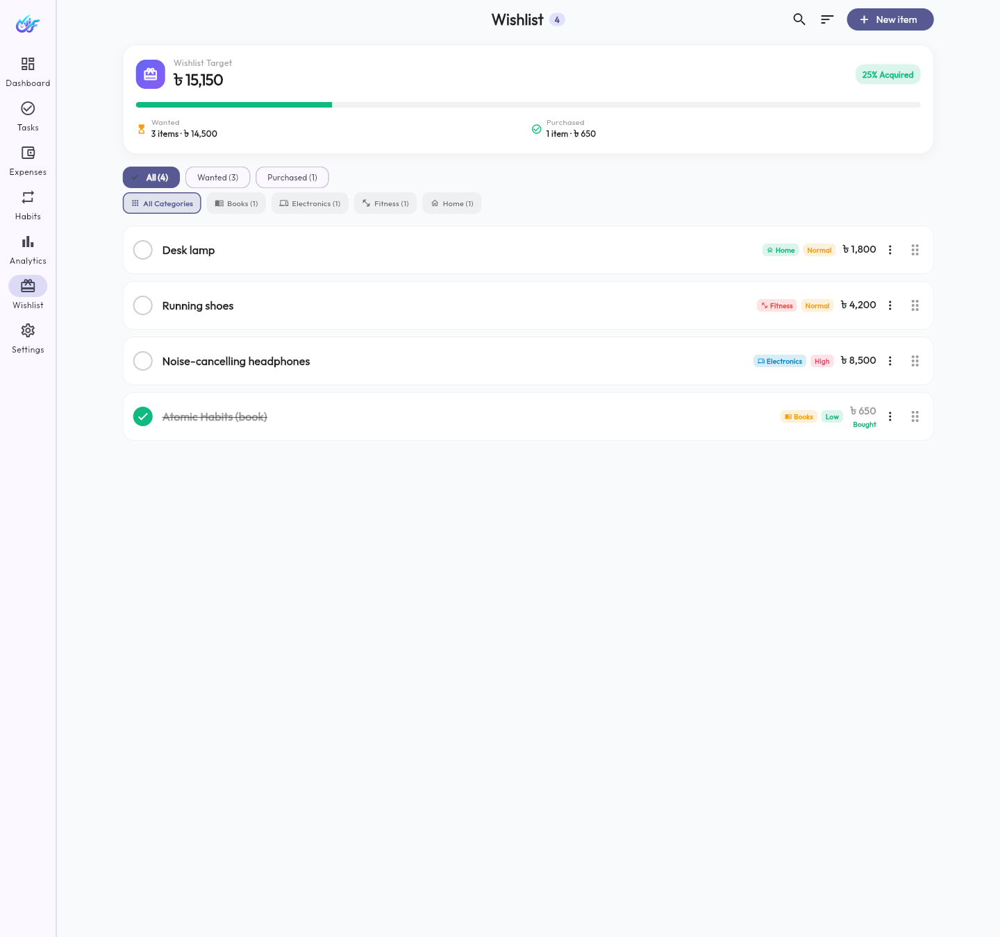
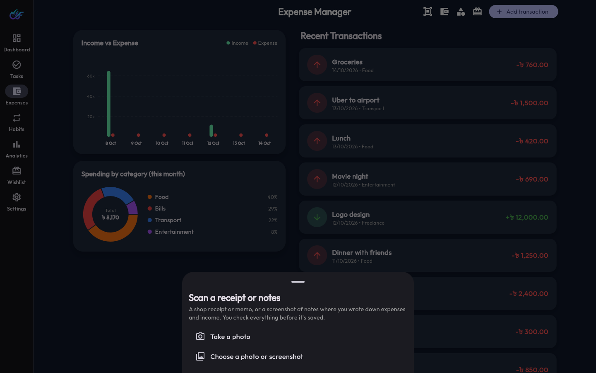

<div align="center">
  

# LifeFlow 🌱

**Your All-In-One Life Management Platform for Phone and Desktop** 📱💻

[](https://flutter.dev)
[](https://laravel.com)
[](https://github.com/SnoOpWo0t/LifeFlow/actions)
[](LICENSE)

</div>

<br />

<div align="center">
  <i>LifeFlow brings your tasks, money and habits under one roof: one Flutter app for web, Android and iOS, backed by a secure Laravel API.</i>
</div>

---

## 📑 Table of Contents

- [About the Project](#-about-the-project)
- [Key Features](#-key-features)
- [Visuals & Demos](#-visuals--demos)
- [Architecture & Code Structure](#️-architecture--code-structure)
- [Tech Stack](#-tech-stack)
- [Quality & Security](#-quality--security)
- [Roadmap](#️-roadmap)
- [Getting Started](#️-getting-started)
- [License](#-license)
- [Contact](#-contact)

---

## 🚀 About the Project

Managing tasks, tracking habits and budgeting usually means juggling several apps that don't talk to each other. **LifeFlow** puts all three in one place.

The UI adapts to the screen. Phones get a bottom navigation bar, a one-lane-at-a-time Kanban board and thumb-reachable buttons. Desktops get a side navigation rail, multi-column layouts and side-by-side charts. Everything is stored per user on the server, so your data and settings follow you to any device.

---

## ✨ Key Features

- **📊 Dashboard:** live weather, a productivity score, **today's tasks** (due today, overdue, or finished today), habit progress, monthly budget overview positioned above live **multi-wallet accounts** (Cash, bKash, Nagad, Bank), Wishlist targets preview, and a recent-activity feed. Two columns on desktop, one on phones.
- **📅 Calendar:** your month at a glance on the dashboard. Each day shows dots for tasks due, habits checked (all or some) and money spent; tap a day to see its tasks, habit check-ins and transactions. A full month grid on desktop; a one-week strip you can expand on phones.
- **📋 Kanban Task Manager:** *To Do*, *In Progress* and *Done* lanes with priorities and due dates. Drag and drop on desktop; a lane switcher and a "Move to…" menu on phones. Deleting asks for confirmation.
- **💰 Expense Tracker:** income and expenses with multi-wallet account tags (`cash`, `bkash`, `nagad`, `bank`), colour-coded categories (create, edit, delete), a monthly budget, an income-vs-expense bar chart and a **spending-by-category donut** for the month. **Tap any transaction to edit or delete it.** The list loads 30 at a time as you scroll. Amounts are shown with thousands separators (`৳ 124,123`).
- **🎁 Wishlist & Target Purchases:** track dream purchases with **customizable categories** (e.g. Perfume, Tech, Fashion, Books, etc.), set estimated prices, assign priorities (Low, Normal, High), store store links, reorder with custom sorting, filter by category or status, and seamlessly convert acquired items into wallet expense transactions with a single tap!
- **📸 AI photo scanner:** take a photo or choose a screenshot of a **receipt**, your **money notes** (Notepad, notes apps, chats, handwriting) or a **shopping list / product page**. Google Gemini reads it (English or Bengali) and you **review every line** before anything is saved: fix names and amounts, switch income/expense, pick categories (new ones are created for you), the date and the wallet. Receipt discounts are shared across items, or save the whole receipt as one expense.
- **🔥 Habit Tracker:** daily check-ins with a small animation (and a vibration on phones), a 7-day view and streaks **calculated from your check-in history**, so they're always accurate. Rename or delete habits from the card menu.
- **📈 Weekly Analytics:** an income-vs-expenses line chart and a daily productivity bar chart, with clean round-number axes.
- **🌦️ Live Weather:** search any city, or tap **"Use my current location"**. Powered by free, key-less APIs (Open-Meteo, BigDataCloud).
- **🔐 Accounts & Settings:** token login with server-side logout, profile photos (automatically resized before upload, shown on the dashboard), **appearance that follows your device** or a fixed Light/Dark choice, settings saved to your account, **Export my data** (everything as JSON, or transactions as CSV for spreadsheets) and **Delete account** (password-confirmed, removes all data).
- **🕒 Your own "today":** the app sends your device's timezone, so habits, today's tasks and weekly charts roll over at *your* midnight, wherever you are.

---

## 📱 Visuals & Demos

### Phone

<div align="center">
  
  
  
  
</div>

### Desktop

<div align="center">
  
  
  
  
  
  
</div>

### Dark mode

<div align="center">
  
  
  
</div>

### Sign in

<div align="center">
  
</div>

### Video Walkthrough

Watch the walkthrough on YouTube (OLD video hasnt been updated) :

[](https://www.youtube.com/shorts/EQXaW4yCKzU)

*Or the quick highlight reel (recorded on an earlier version of the UI):*

<div align="center">
  
</div>

---

## 🏗️ Architecture & Code Structure

The project is split into two apps that talk over HTTP: a **Laravel REST API** and a **Flutter client**.

* 🛡️ **Security:** the database and business rules (validation, ownership checks, streak calculation) live on the server. The Flutter app never touches the database directly.
* 🚀 **Scalability:** the API and the web app can be hosted separately; the same Flutter code builds for web, Android and iOS.
* 🔄 **Reusability:** any future client (another website, a desktop app) can use the same API.

```text
LifeFlow/
├── .github/workflows/ci.yml       # Automatic tests on every push (GitHub Actions)
├── lifeflow-api/                  # Backend REST API (Laravel)
│   ├── app/Http/Controllers/      # Auth, Dashboard, Calendar, Tasks, Expenses, Wishlist, Habits, Analytics, Profile
│   ├── app/Http/Requests/         # Validation rules, one class per action (Form Requests)
│   ├── app/Http/Resources/        # The exact JSON shape returned for each model (API Resources)
│   ├── app/Http/Middleware/       # Remembers each user's timezone (X-Timezone header)
│   ├── app/Services/              # Gemini client + photo reader (prompts, schemas, cleaning)
│   ├── app/Policies/              # "Only the owner may edit/delete" rules
│   ├── app/Models/                # Eloquent models
│   ├── routes/api.php             # 40 endpoints under /api/v1
│   ├── database/migrations/       # Database schema (14 migrations)
│   └── tests/Feature/             # Feature & API tests (ApiTest.php, WishlistTest.php)
│
└── lifeflow_app/                  # Frontend (Flutter)
    ├── lib/
    │   ├── core/                  # API client, storage, theme, formatters
    │   ├── features/              # One folder per feature: data / domain / presentation
    │   │   ├── auth/              # Sign in / sign up
    │   │   ├── dashboard/         # Summary + live weather
    │   │   ├── calendar/          # Month-at-a-glance calendar + day details
    │   │   ├── tasks/             # Kanban board
    │   │   ├── expenses/          # Transactions, categories, budget, multi-wallet
    │   │   ├── wishlist/          # Target purchases with custom categories & expense conversion
    │   │   ├── scan/              # AI photo scanner: pick a photo, review, save
    │   │   ├── habits/            # Habit cards and streaks
    │   │   ├── analytics/         # Weekly charts
    │   │   └── settings/          # Profile, preferences, weather location
    │   ├── main.dart              # App entry point
    │   └── main_screen.dart       # Responsive navigation (6-destination bar with modal sheet / side rail)
    └── test/app_test.dart         # Flutter unit and widget tests (19 tests)
```

More detail (database tables, every endpoint) is in [PROJECT_BLUEPRINT.md](PROJECT_BLUEPRINT.md).

---

## 💻 Tech Stack

**Frontend (web, Android, iOS)**

- **Framework:** [Flutter](https://flutter.dev/) (Dart 3)
- **State management:** [Riverpod](https://riverpod.dev/)
- **Networking:** Dio
- **Charts:** fl_chart
- **Other:** google_fonts, image_picker, geolocator, flutter_timezone, shared_preferences

**Backend (REST API)**

- **Framework:** [Laravel 13](https://laravel.com/) on PHP 8.3+
- **Authentication:** Laravel Sanctum (revocable API tokens)

**Database**

- **Development:** SQLite (a single local file)
- **Production:** PostgreSQL (e.g. Neon's free tier); see [NEXT_LEVEL_ROADMAP.md](NEXT_LEVEL_ROADMAP.md)

**Free external APIs (no keys needed)**

- [Open-Meteo](https://open-meteo.com/): weather forecasts and city search
- [BigDataCloud](https://www.bigdatacloud.com/): turning your location into a city name

**AI (optional, free tier)**

- [Google Gemini](https://aistudio.google.com/): reads receipts, notes and shopping lists. The key lives only in the API's `.env`; the app never sees it

---

## ✅ Quality & Security

- **Automated tests:** 56 backend tests (PHPUnit) and 24 Flutter tests, run on every push by GitHub Actions.
- **Data isolation:** every edit and delete goes through Laravel Policies, and lists and new records are always scoped to the signed-in user, so nobody can read or change anyone else's data (covered by tests).
- **Login protection:** passwords are hashed, login/register are limited to 10 attempts per minute, logout revokes the token on the server, and an expired session returns you to the sign-in screen.
- **Validation:** on the server for every request (Laravel Form Requests), and in the forms before anything is sent.
- **No data leaks in responses:** API Resources return only the fields the app needs (never internal columns such as `user_id` or `provider`).
- **Private profile photos:** served only through signed links that expire, not a permanent public URL.
- **Your data is yours:** export everything at any time, or delete the account and all its data.
- **AI with guard-rails:** the scanner never saves on its own (you review first), every value Gemini returns is validated and clamped on the server, and each user has a daily photo limit so the key can't be abused.

---

## 🛣️ Roadmap

- [X]  Appearance: follow the device, or always Light / Dark
- [X]  Live weather with city search and geolocation
- [X]  Edit and delete transactions and categories; rename and delete habits
- [X]  Spending-by-category chart
- [X]  Dashboard calendar (month at a glance + day details)
- [X]  Delete account (with all data) and export my data (JSON / CSV)
- [X]  Per-user timezone, paginated transactions, private profile photos
- [X]  AI photo scanner for receipts, money notes and shopping lists (Gemini)
- [X]  Responsive layouts for phone and desktop
- [X]  Automated tests and CI
- [X]  Wishlist & target purchases (custom categories, priority, drag-and-drop sort, store link, 1-tap expense conversion)
- [X]  Multi-wallet accounting (Cash, bKash, Nagad, Bank balances per transaction and dashboard card)
- [X]  Decluttered bottom navigation with IndexedStack tab state preservation
- [ ]  Reminders / push notifications for habits and overdue tasks
- [ ]  Sign in with Google
- [ ]  Multi-currency support
- [ ]  AI assistant for adding tasks in plain language
- [ ]  Public deployment (free hosting)

The full prioritised list, all of it doable for free, is in [NEXT_LEVEL_ROADMAP.md](NEXT_LEVEL_ROADMAP.md), including ideas from the [Catalyst](https://github.com/HAVIC-47/catalyst-app) app (AI summaries, mood tracking, category budgets, bills, an installable Android app…).

---

## 🛠️ Getting Started

Step-by-step instructions for **Linux and Windows**, including troubleshooting, are in **[HOW_TO_RUN.md](HOW_TO_RUN.md)**. Short version:

### Prerequisites

- PHP 8.3+ with the `mbstring`, `xml`, `curl`, `sqlite3`, `zip`, `bcmath` and `intl` extensions
- [Composer](https://getcomposer.org/) (a copy is included at `php/composer.phar`)
- [Flutter SDK](https://docs.flutter.dev/get-started/install) (stable channel)

### 1. Backend (Laravel)

```bash
cd lifeflow-api
composer install                      # or: php ../php/composer.phar install
cp .env.example .env
php artisan key:generate
touch database/database.sqlite
php artisan migrate
php artisan storage:link
# Optional: AI photo scanning. Put a free key from aistudio.google.com in .env:
# GEMINI_API_KEY=your-key
php artisan serve                     # → http://127.0.0.1:8000
```

### 2. Frontend (Flutter)

```bash
cd lifeflow_app
flutter pub get
flutter run -d web-server --web-port 8080     # → http://localhost:8080
```

### 3. Run the tests

```bash
cd lifeflow-api && php artisan test
cd lifeflow_app && flutter analyze && flutter test
```

---

## 📜 License

Distributed under the MIT License. See `LICENSE` for more information.

---

## 📬 Contact

**Afrin Sultana Akhi**, Creator & Lead Developer

- **Portfolio:** [afrinsultana-akhi.vercel.app](https://afrinsultana-akhi.vercel.app/)
- **LinkedIn:** [afrin-sultana-akhi](https://www.linkedin.com/in/afrin-sultana-akhi-1ab3a4422/)
- **GitHub:** [@SnoOpWo0t](https://github.com/SnoOpWo0t)

<p align="right"><a href="#lifeflow-">⬆️ Back to top</a></p>
